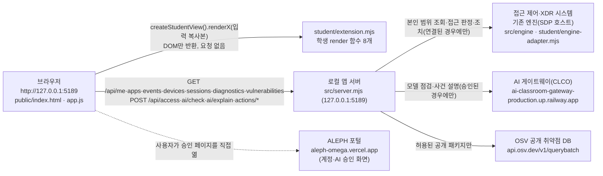

# 케셰브 학생 실행 설명서 (13~20단계 구현본)

이 문서는 이 저장소(`muji80709817-rgb/aleph`)를 처음 받은 사람이 **실제 폴더와 명령을 확인하며** 앱을 켜고 끄고, 학생이 구현한 부분과 제공된 부분을 구분해 이해할 수 있게 쓴 학생 문서입니다. 제공 문서(`README.md`의 기존 내용, `docs/STUDENT_LAUNCH_GUIDE.md` 등)는 고치지 않았고, 이 파일을 새로 추가했습니다.

각 항목에는 어떻게 확인했는지를 적었습니다.

- **실행 확인**: 이 PC에서 명령을 실제로 실행해 결과를 봤습니다.
- **코드 확인**: 코드만 읽고 확인했습니다. 실행하지 않았습니다.
- **모의 확인**: 가짜 입력 데이터로 학생 함수만 따로 실행해 봤습니다. 실제 브라우저 화면은 아닙니다.
- **미확인**: 확인하지 못했습니다. 동작한다고 보지 않습니다.

---

## 1. 목적과 기능

케셰브는 회사 직원이 **자기 로그인 상태, 기기·세션, 업무 앱 접속 판정, 접속·XDR 보안 기록, 설치 패키지 취약점, AI 사건 설명, 조치 요청 상태**를 한 화면에서 보는 보안 앱입니다. 판정·탐지·집행은 기존 엔진(SDP 서버)과 연동 시스템이 하고, 이 앱은 **보여 주고, AI 설명을 요청하고, 사람이 확인한 조치만 전달**합니다. AI는 설명과 제안만 하며 스스로 조치를 실행하지 않습니다.

## 2. 지원 환경과 버전

| 항목 | 요구 | 이 PC에서 확인한 값 | 확인 방법 |
|---|---|---|---|
| 운영체제 | Windows (실행 도구가 PowerShell 스크립트) | Windows 11 Pro | 실행 확인 |
| Node.js | 22~24, 수업 기준 24.19.0 (`package.json`의 `engines.node`) | v24.21.0 | 실행 확인(`node --version`). 실행 도구가 "참고: 지금 Node.js 는 v24.21.0 입니다. 수업 기준은 v24.19.0 입니다."를 출력하고 계속 실행됨 |
| Git | 커밋·제출용 | 2.55.0.windows.5 | 실행 확인(`git --version`) |
| npm 의존성 | 없음 (`package.json`에 dependencies 없음, `package-lock.json` 없음) | 설치할 것 없음 | 코드 확인 |
| 브라우저 | PC 브라우저 | Claude 데스크톱 앱 내장 브라우저 | 실제 화면(22단계 재현, `docs/RELEASE_RECORD.md` 3장) |
| 시작 틀 버전 | `package.json` name `alekov-client-starter`, version `0.2.11` | 0.2.11 | 코드 확인 |

지원하지 않거나 확인하지 않은 환경:
- macOS·Linux에서는 `tools\start-alekov.ps1`을 쓸 수 없습니다. `npm start`로는 켤 수 있을 것으로 보이지만 **미확인**입니다.
- Node.js 22, 23과 수업 기준 24.19.0에서는 실행해 보지 않았습니다(**미확인**). 실제로 실행해 본 것은 v24.21.0뿐입니다.

## 3. 폴더 구조

이 저장소는 **최상위 폴더가 곧 앱 폴더**입니다. 제공 안내서(`STUDENT_LAUNCH_GUIDE.md`)에 나오는 `on-client` 하위 폴더는 이 저장소에 없습니다. 실행 도구는 `tools`의 상위 폴더에 `src\server.mjs`와 `package.json`(name `alekov-client-starter`)이 있는지만 검사합니다. (코드 확인: `tools/start-alekov.ps1` 1번 단계)

```text
<저장소를 받은 폴더>\   ← Git 최상위 = 앱 폴더 (PowerShell을 여기서 엽니다)
├─ package.json            제공 · 실행 스크립트(start / demo / check)
├─ .env.example            제공 · 비밀 없는 설정 견본(서버가 자동으로 읽지 않음)
├─ README.md               제공 · 맨 아래 "학생 문서" 절과 링크 한 줄만 학생이 추가
├─ tools\start-alekov.ps1  제공 · Node 버전·포트 확인 후 서버 실행
├─ src\                    제공 · 로컬 앱 서버
│  ├─ server.mjs           HTTP 서버, /api/* 경로
│  ├─ engine.mjs           기존 엔진 어댑터 불러오기·예제 엔진
│  ├─ engine\              SDP 호스트 연결
│  ├─ ai\                  AI 게이트웨이 연결·앱 권한
│  ├─ actions\             조치 준비·집행·결과 조회
│  ├─ connection\          계정 연결(native 로그인)
│  ├─ learner-support\     학습 지원
│  └─ vulnerabilities\     package-lock 대조·OSV 조회
├─ public\                 제공 · 브라우저 화면
│  ├─ index.html           화면 틀, 학생 칸(student-*) 자리
│  ├─ app.js               제공 화면 로직, 학생 함수 호출
│  ├─ vulnerabilities-view.mjs, ai-connect.mjs, style.css, assets\
├─ student\                학생 작성
│  ├─ extension.mjs        학생 구현 함수 8개 (13~20단계)
│  └─ engine-adapter.mjs   제공 견본(기존 엔진 연결용, 이번 과제에서 수정하지 않음)
├─ vendor\clco-http.mjs    제공 · AI 게이트 HTTP 도우미
└─ docs\                   제공 문서 + 이 학생 문서(STUDENT_RUNBOOK.md)
```

## 4. 실행·종료·재실행

### 4.1 PowerShell을 여는 위치
1. 파일 탐색기에서 이 저장소를 받은(clone한) 폴더를 엽니다. 예: `git clone https://github.com/muji80709817-rgb/aleph.git`로 받았다면 만들어진 `aleph` 폴더입니다. 특정 PC의 절대경로에 의존하지 않습니다.
2. 주소 표시줄에 `powershell`을 입력하고 Enter를 누릅니다.
3. 창 제목이나 프롬프트가 이 폴더 경로인지 확인합니다.

### 4.2 켜기 (권장)
```powershell
powershell -NoProfile -ExecutionPolicy Bypass -File .\tools\start-alekov.ps1
```

**정상 시작 신호** (실행 확인, 2026-11-04, `-Background` 옵션으로 실행): 아래 줄이 나오면 서버가 응답한 것입니다.
```text
참고: 지금 Node.js 는 v24.21.0 입니다. 수업 기준은 v24.19.0 입니다.   ← Node가 24.19.0이 아닐 때만
케셰브가 켜졌습니다. 브라우저에서 http://127.0.0.1:5189/ 을 여세요.
서버가 응답한 것만 확인했습니다. AI 연결 상태는 화면에서 따로 확인해 주세요.
끄려면 이 창에서 Ctrl+C 를 누르세요.                                   ← 창 모드일 때
```

같은 실행에서 `GET http://127.0.0.1:5189/api/diagnostics`가 200으로 응답했습니다. 응답에는 `engine.mode: "disconnected"`, `engine.code: "ENGINE_NOT_CONNECTED"`, `ai.configured: false`가 들어 있었습니다. 즉 **기본 실행은 기존 엔진과 AI 게이트에 연결되지 않은 상태**입니다. 이 상태는 실행 실패가 아니라, 연결 설정이 없을 때의 정상 상태입니다.

**브라우저 주소**: `http://127.0.0.1:5189/`
- 서버가 `127.0.0.1`에서만 열리므로, 같은 PC의 브라우저에서만 접속됩니다. (코드 확인: `server.listen(port,'127.0.0.1')`)
- 22단계 재현에서 이 주소를 열어 제목 "케셰브 · ZTNA & XDR"과 학생 칸 8개가 표시되는 것을 확인했습니다(실제 화면, `docs/RELEASE_RECORD.md` 3장).

### 4.3 다른 켜는 방법

| 명령 | 뜻 | 확인 |
|---|---|---|
| `npm start` | 같은 서버를 켭니다(`node src/server.mjs`). Node 버전·포트를 미리 검사하지 않습니다. 시작 시 `케셰브 연결 확인: http://127.0.0.1:5189`를 출력합니다 | 코드 확인 |
| `npm run demo` | 예제 자료로 켭니다(`--demo`). **실제 연결이 아닙니다.** `케셰브 예제: http://127.0.0.1:5189`를 출력합니다 | 코드 확인 |
| `npm run check` | `student/extension.mjs`의 문법만 검사합니다(`node --check`) | 실행 확인(`node --check student/extension.mjs` 통과) |
| `...start-alekov.ps1 -Port 5190` | 5189를 다른 프로그램이 쓸 때 사용합니다. 브라우저 주소도 `:5190`으로 엽니다 | 코드 확인 |
| `...start-alekov.ps1 -Background` | 창 없이 켭니다. 출력된 프로세스 번호로 끕니다 | 실행 확인 |
| `...start-alekov.ps1 -Demo` | 예제 모드로 켭니다. SDP 설정과 함께 쓸 수 없습니다 | 코드 확인 |

### 4.4 종료
- **창 모드**: 앱을 켠 PowerShell 창에서 `Ctrl+C`를 누릅니다. (코드 확인)
- **`-Background` 모드**: 출력된 "프로세스 번호 N"의 node를 작업 관리자에서 끄거나, PowerShell에서 아래를 실행합니다.
  ```powershell
  Stop-Process -Id N
  ```
  실행 확인: 위 명령으로 끈 뒤 `http://127.0.0.1:5189/`가 응답하지 않는 것을 확인했습니다.
- **종료 확인 신호**: 브라우저에서 주소를 새로 고쳤을 때 열리지 않으면 꺼진 것입니다.

### 4.5 다시 실행
같은 폴더에서 4.2의 명령을 다시 실행합니다. 켜고 끄는 것만으로는 내 파일이 바뀌지 않습니다. 다시 켜면 화면 상태(점검 결과, 선택한 기록 등)는 처음 상태로 돌아갑니다. 학생 함수는 저장소나 브라우저 저장소에 값을 남기지 않습니다. (코드 확인)

### 4.6 설정값
- `.env.example`은 **견본**입니다. 서버는 `.env` 파일을 자동으로 읽지 않고 실행 환경변수(`ON_PORT`, `ON_ENGINE_ADAPTER`, `ON_PROJECT_DIRECTORY`, `ON_APPROVED_PUBLIC_PACKAGES` 등)만 읽습니다. (코드 확인: `src/server.mjs`)
- 실행 도구는 이름에 TOKEN·SECRET·PASSWORD·API_KEY 등이 들어간 환경변수를 서버에 넘기지 않습니다. (코드 확인)
- 키·토큰·비밀번호는 이 문서와 저장소 어디에도 적지 않았습니다.

## 5. 시스템 구성도

### 5.1 Mermaid


### 5.2 같은 내용을 글로 쓴 ASCII
```text
[브라우저 http://127.0.0.1:5189]
   │  public/app.js (제공) ── renderX(입력) ──▶ student/extension.mjs (학생, DOM만 반환)
   │
   ▼  /api/*  (같은 PC 안에서만)
[로컬 앱 서버 src/server.mjs]
   ├──▶ 접근 제어·XDR 시스템 (기존 엔진/SDP 호스트)   ← 설정 없으면 disconnected
   ├──▶ AI 게이트웨이 (CLCO)                         ← 계정 연결·AI 승인 전에는 권한 준비 중/확인 불가
   └──▶ OSV 공개 DB                                   ← 허용 목록이 비면 외부 조회 안 함
```

### 5.3 표

| 출발 | 도착 | 경로·주소 | 언제 | 비고 |
|---|---|---|---|---|
| 브라우저 | 로컬 앱 서버 | `/api/me`, `/api/apps`, `/api/events`, `/api/devices`, `/api/sessions` | 처음 열 때와 「다시 불러오기」 | 학생 코드는 요청을 보내지 않음 |
| 브라우저 | 로컬 앱 서버 | `POST /api/access` | 업무 앱 접속 요청 | 판정은 엔진이 함 |
| 브라우저 | 로컬 앱 서버 | `GET /api/diagnostics` | 「도움정보 불러오기」 | 비밀 없는 점검 결과 |
| 브라우저 | 로컬 앱 서버 | `GET /api/vulnerabilities` | 「설치 패키지 조회」 | |
| 브라우저 | 로컬 앱 서버 | `POST /api/ai/check`, `POST /api/ai/explain` | 「현재 API 연결 점검」/「AI 연결 점검」, 「AI 설명 요청」 | |
| 브라우저 | 로컬 앱 서버 | `POST /api/actions/prepare`·`execute`·`result` | 「<조치> 조치 준비」, 「대상과 조치를 확인했으며 집행합니다」, 「원천 결과만 재조회」 | 지금 기록은 supportedActions가 비어 있어 이 경로가 열리지 않음 |
| 로컬 앱 서버 | 접근 제어·XDR 시스템 | 엔진 어댑터 / SDP 호스트 | 설정이 있을 때만 | 이 PC 기본 실행: `ENGINE_NOT_CONNECTED`(실행 확인) |
| 로컬 앱 서버 | AI 게이트웨이 | `https://ai-classroom-gateway-production.up.railway.app` | 계정 연결·AI 승인 후 | 키는 서버 쪽 보관함에만 있음. 문서·코드에 없음 |
| 로컬 앱 서버 | OSV | `https://api.osv.dev/v1/querybatch` | 허용된 공개 패키지가 있을 때 | 비공개·미허용 패키지 이름은 밖으로 보내지 않음 |

## 6. 제공 부분과 학생 작성 부분

| 구분 | 파일 | 누가 | 이번 과제에서 |
|---|---|---|---|
| 로컬 서버·API | `src/**` | 제공 | 수정하지 않음 |
| 화면 틀·제공 로직 | `public/**` | 제공 | 수정하지 않음 |
| 실행 도구 | `tools/**` | 제공 | 수정하지 않음 |
| 학생 화면 함수 | `student/extension.mjs` | **학생** | 13~20단계에서 구현 |
| 엔진 어댑터 견본 | `student/engine-adapter.mjs` | 제공 견본 | 수정하지 않음 |
| 학생 문서 | `docs/STUDENT_RUNBOOK.md`, `README.md` 맨 아래 "학생 문서" 절과 "더 읽을 곳"의 링크 한 줄 | **학생** | 21단계에서 추가 |
| 버튼 이름 정정 | `student/extension.mjs` 안내 문구 | **학생** | 21단계에서 실제 버튼 이름(「원천 결과만 재조회」, 「<조치> 조치 준비」, 「AI 연결 점검 취소」)으로 맞춤 |

**경계**
- 제공 `public/app.js`는 학생 함수에 **입력의 복사본(structuredClone)**만 넘깁니다.
- 학생 함수는 DOM 요소나 글자만 돌려줍니다. 학생 코드는 `fetch`·POST·저장소 쓰기·자동 재시도를 하지 않습니다.
- 학생 코드는 확인 번호·티켓·키를 받지도, 만들지도 않습니다.
- 모든 글자는 `textContent`로 넣습니다(`innerHTML` 미사용).

(코드 확인: `public/app.js`의 `studentData`·`renderStudent`, `student/extension.mjs`)

### 6.1 학생이 구현한 함수

| 함수 | 단계 | 화면 칸(id) | 입력 | 주요 표시 |
|---|---|---|---|---|
| `renderIdentity` | 13 | `student-identity` | `{ me, devices, sessions }` | 사용자·기기·세션, 불러오는 중/실패/확인 불가 |
| `renderDecision` | 14 | `student-decision` | `{ status, mode, data, error, appId }` | allow/deny/challenge/unknown, 요청 실패 ≠ 거부 |
| `renderEvents` | 15 (16에 추가) | `student-events` | `{ status, mode, data, error }` | 최신순 목록, 종류·앱·접속 상태 걸러 보기, 상세(`data-student-event-detail`), 16단계 `<action> 미지원` 비활성 버튼 |
| `renderStatus` | 16 | `student-status` | `{ devices, sessions, notifications, diagnostics, mode }` | 불러오는 중/빈 목록/실패(시간 초과 구분), 알림, 도움정보 6개 필드, 「도움정보 복사」 버튼 |
| `renderAiConnection` | 17 | `student-ai-connection` | `{ status, mode, data, error, checkedAt, explanationAccepted }` | 점검 전/중, test·verified, modelCount, "사건 설명은 아직 실행하지 않았습니다", 오류 원인별 안내 |
| `renderExplanation` | 17·18 | `student-explanation` | `{ event, explanation, checkedAt }` | 성공 시에만 `data-student-explanation-event`, 근거 ID 대조, 규칙, 확인 불가 상태, 제안(미실행) |
| `renderAction` | 19 | `student-action` | `{ status, event, actionId, target, receipt, observation, message, confirmationExpiresAt, error }` | 11개 상태 구분, ACK ≠ 효과, effectApplied===true일 때만 효과 확인, `data-student-action-event`/`-request` |
| `renderVulnerabilities` | 20 | `student-vulnerabilities` | `{ status, mode, data, error }` | idle/loading/error/ok, 전체 상태 5종, 정확한 설치 버전, `data-student-package-name`/`-version`, 취약점 id·modified |

## 7. 확인한 기능과 확인하지 않은 기능

새 폴더 재현 절차, 단계별 결과, 데이터 보존 계획, 버전과 미해결 사항은 `docs/RELEASE_RECORD.md`(22단계)에 있습니다.

| 기능 | 결과 | 확인 방법 |
|---|---|---|
| 실행 도구로 서버 켜기, 시작 신호 출력 | 됨 | 실행 확인 |
| `/api/diagnostics` 응답(엔진 disconnected, AI 미설정) | 됨 | 실행 확인 |
| `-Background` 실행 후 `Stop-Process`로 종료 | 됨 | 실행 확인 |
| `student/extension.mjs` 문법 | 통과 | 실행 확인(`node --check`) |
| 16~20단계 학생 함수의 상태별 문장·속성 | 의도대로 나옴 | 모의 확인(가짜 DOM과 가짜 입력으로 함수 실행) |
| 브라우저에서 학생 칸 8개가 보이는지 | 보임(미연결 상태 표시) | 실제 화면(22단계 재현) |
| 자동 재요청이 없는지, 「다시 불러오기」를 누를 때만 요청하는지 | 10초 동안 추가 요청 0건, 클릭 시 5개 경로 각 1회 | 실제 화면(22단계 재현) |
| 「다시 불러오기」 후 이전 실패 안내가 사라지는지(실제 화면) | — | **미확인**. 엔진 미연결이라 다시 불러와도 성공 응답이 오지 않음(코드상으로는 입력만으로 새로 그림) |
| 「도움정보 복사」 클립보드 복사(실제 브라우저) | — | **미확인**(모의 확인에서는 6개 필드만 복사됨) |
| 계정 연결·AI 연결·AI 사건 설명 | — | **미확인**. 운영자 권한 준비가 필요하며 유료 요청은 하지 않음 |
| 기존 엔진(SDP) 연결, 실제 접근 판정·보안 기록 | — | **미확인**. 기본 실행은 `ENGINE_NOT_CONNECTED` |
| 조치 준비·집행·결과 재조회 | — | **미확인**. 지원 조치가 없어 경로가 열리지 않으며, 시험 집행도 하지 않음 |
| OSV 실제 조회 | — | **미확인**. `ON_PROJECT_DIRECTORY`가 비어 있고 이 저장소에는 `package-lock.json`이 없어 `not_configured`가 예상됨(코드 확인) |
| 예제 모드 표시 | `start-alekov.ps1 -Demo -Port 5191`로 예제 기기·세션·기록 표시 | 예제(demo), 22단계 재현. 실제 연결이 아님 |
| `npm start`, `npm run demo` | — | **미확인**(코드 확인만 함) |

## 8. 문제가 생겼을 때 (오류별 확인 순서)

실행 도구는 다른 프로그램을 끄거나, 무언가를 설치하거나, 파일을 지우지 않습니다. 원인을 고친 뒤 같은 폴더에서 다시 실행합니다. 오류 코드 전체 목록은 `docs/CONNECTION_TROUBLESHOOT.md`에 있습니다.

| 증상(실제 메시지·코드) | 어디서 나오나 | 확인 순서 | 복구 |
|---|---|---|---|
| `Node.js 가 없습니다` / `지금 Node.js 는 vXX 입니다` | `tools/start-alekov.ps1` 2번 단계 | ① `node --version` ② 22~24인지 확인 | Node.js 24.19.0 설치 → 새 PowerShell 창 |
| `포트 5189 를 다른 프로그램이 쓰고 있습니다` | 실행 도구 3번 단계 | ① 이미 켠 케셰브 창이 있는지 확인 | 그 창을 쓰거나, `-Port 5190`으로 켜고 `:5190` 주소로 접속 |
| `앱 폴더가 아닙니다` / `시작 틀 폴더가 아닙니다` | 실행 도구 1번 단계 | ① 현재 폴더에 `src\server.mjs`, `package.json`이 있는지 확인 | 이 저장소 최상위 폴더에서 다시 실행 |
| `앱 서버가 20 초 안에 뜨지 않았습니다` | 실행 도구 5번 단계 | ① 창의 메시지 전체 확인 ② `npm run check`로 학생 코드 문법 확인 | 메시지와 도움정보를 강사에게 전달 |
| 학생 칸에 `학생 구현 renderX 실행 중 오류가 발생했습니다` | `public/app.js` `renderStudent` | ① `npm run check` ② 브라우저 개발자 도구 콘솔 | `student/extension.mjs` 수정 후 브라우저 새로 고침. 제공 화면은 계속 동작함 |
| 위쪽 표시가 `연결 없음(disconnected)` / `ENGINE_NOT_CONNECTED` | 서버 기본 상태 | ① `-SdpHostConfig`를 안내받았는지 확인 | 학생이 할 일 없음. 연결 실패가 아니라 미연결 상태 |
| 기기·세션 칸에 `불러오기 실패(시간 초과)` / `TIMEOUT` | `renderStatus` | ① 서버 창이 켜져 있는지 확인 | 위쪽 「다시 불러오기」를 **직접** 누름. 자동 재요청 없음 |
| AI 칸에 `권한 준비 중·확인 불가` / `ON_AI_PROVISIONING_PENDING` | `renderAiConnection` | ① 계정 연결을 끝냈는지 ② AI 승인을 끝냈는지 | 학생 잘못이 아님. 담당자에게 앱 권한 확인을 요청 |
| AI 칸에 `인증 실패` / `WB_CLCO_AUTH_REQUIRED` | 〃 | ① 「계정 연결 시작」부터 다시 | 계속되면 담당자에게 확인. 키를 복사해 붙이지 않음 |
| AI 칸에 `사용량·이용 한도` / `이용 시간 아님` / `요청 제한` | 〃 | ① 오류 코드 확인 | 한도는 담당자 확인, 시간은 이용 시간 확인, 요청 제한은 잠시 뒤 직접 다시 점검 |
| AI 설명 칸에 `근거가 맞지 않음` / `ON_AI_INVALID_OUTPUT` | `renderExplanation` | ① 선택한 기록이 맞는지 | 이 설명은 쓰지 않음. 기록은 그대로이며 과제 실패가 아님 |
| 조치 칸에 `결과 불명(unknown)` | `renderAction` | ① 효과 없음으로 판단하지 않음 | 「원천 결과만 재조회」를 직접 누름. 「조치 화면 취소」는 이미 전달된 효과를 되돌리지 않음 |
| 패키지 칸에 `조회 준비 미완료(not_configured)` / `아직 조회 안 함(not_checked)` | `renderVulnerabilities` | ① 담당자가 조회 대상·허용 목록을 준비했는지 | 정상 미조회 상태. 학생이 설정이나 의존성을 임의로 바꾸지 않음 |
| 패키지 칸에 `조회 실패: …` | 〃 | ① 오류 코드 확인 | 「설치 패키지 조회」를 직접 다시 누름. 실패는 "취약점 없음"이 아님 |

## 9. 제출 전 확인

1. `npm run check`로 문법을 확인합니다.
2. 바뀐 파일만 커밋합니다(`git status`로 확인). 그다음 `git push`합니다.
3. 포털에 저장소 주소와 40자리 커밋을 입력합니다. 비공개 저장소라면 과제 화면의 원문 전달 도구로 만든 JSON도 함께 선택합니다.
